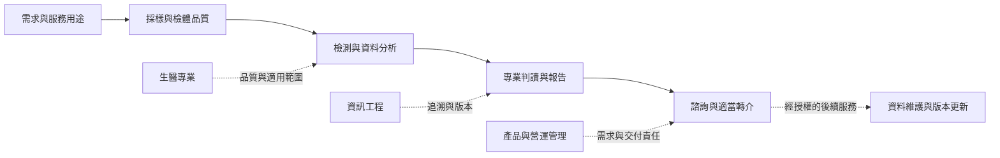

# 先見基因：基因檢測產業個案分析

**產業研究 · 商業模式分析 · 跨領域創新與管理**

[English](README.en.md) · [完整個案分析](docs/case-study.md) · [產業結構](docs/industry-analysis.md) · [商業模式](docs/business-model.md) · [原稿節選](docs/source-map.md)

這份個案研究探討：**基因檢測公司如何整合生醫專業、資訊工程與管理，把檢測資料轉成客戶能理解、專業人員能判讀的服務？**

研究以《跨領域創新與管理》第五組「科學算命」期末簡報為起點，以使用者指定的先見基因科技（i-Genomics）為個案，將產品介紹延伸為產業定位、價值創造、跨專業協作及策略取捨的分析。

**作品整理：李奕成 Eason，2026 年 10 月。原始簡報為八人團隊成果。** 原稿未記載個別分工；本次分析與歷史團隊成果的界線見 [貢獻說明](docs/contribution.md)。

## 個案的核心判斷

**這個產業的價值，取決於檢測、解讀與後續服務能否接得起來。**

原稿把健康風險評估、癌症伴隨性診斷、青春指數追蹤及基因銀行放在同一個服務組合中。它們的使用情境與證據要求不同，應分別分析；不能把某一類檢測的能力推廣成所有產品的醫療效果。

本案提出三個管理判斷，均屬待驗證的分析：

1. **服務交接可能比增加檢測項目更值得先改善。** 採樣、分析、報告與諮詢之間，任何一段無法接續，都可能削弱客戶取得的價值。
2. **跨領域合作需要可交付的介面。** 生醫人員、工程師與管理者需要共同確認檢測用途、資料規格、報告限制及變更責任。
3. **長期資料服務需要持續維護能力。** 「基因銀行」可以形成服務延伸的機會，也增加版本管理、授權與支援的長期責任；尚不能據此認定有訂閱收入或平台網路效應。

## 從產業問題走到公司個案

| 分析層次 | 本案追問 | 對先見基因的分析意涵 |
| --- | --- | --- |
| 產業結構 | 誰提供技術、誰解讀、誰付費、誰決定使用？ | 檢測公司同時面對消費者、專業服務者與合作機構，價值不能只由項目數衡量 |
| 商業模式 | 一次檢測如何連結後續服務？ | 拆開檢測交易、諮詢交付與資料維護，檢查各自的成本與責任 |
| 組織協作 | 生醫與工程的知識如何形成產品？ | 以需求規格、例外回報、報告簽核及版本紀錄承接跨專業交接 |
| 服務品質 | 客戶認為重要的事情，是否做得好？ | 將原稿的 Kano、IPA 概念轉成可執行的調查設計，保留尚未量測的狀態 |
| 策略選擇 | 先擴產品、強化解讀，或發展長期服務？ | 優先建立可理解的報告與交接流程，再依試點資料決定是否擴大 |

此圖為本次建立的分析架構，不代表已查證的企業內部流程或已完成的系統實作。

## 閱讀路線

- [個案分析](docs/case-study.md)：研究問題、三個關鍵矛盾、推論與替代解釋。
- [產業結構與競爭邏輯](docs/industry-analysis.md)：價值鏈、替代方案、信任與議價關係。
- [商業模式拆解](docs/business-model.md)：客群、價值、通路、收入假說與成本結構。
- [跨領域創新機制](docs/cross-domain-innovation.md)：原稿頁碼、知識介面、Kano 與 IPA 的使用邊界。
- [策略與驗證設計](docs/strategy-and-validation.md)：方案比較、指標定義與試點決策條件。
- [證據清單](evidence/evidence-register.csv)、[來源與限制](docs/provenance.md)、[參考來源](docs/references.md)。

## 原始成果與本次整理

| 層次 | 收錄內容 | 可支持的結論 |
| --- | --- | --- |
| 歷史課程成果 | 31 頁原簡報的頁碼導覽與 3 張安全節選 | 團隊當時如何描述產品、流程與跨領域知識 |
| 官網補充 | 2026-10-28 查閱的公司第一方頁面 | 公司目前公開如何定位服務，不等於獨立績效查核 |
| 本次再分析 | 產業、商業模式、協作機制與策略文件 | 有來源的管理推論及尚待驗證的方案 |

完整原稿含檢測報告示例與 QR code，保留於本機，未放入公開庫。公開內容不收錄個人檢測數據。歷史課程年份未確認，PDF 的匯出日期不作為課程日期。

「科學算命」沿用課程題目。基因風險資訊不等於確定的個人命運；FDA 的消費者說明也區分遺傳風險與整體疾病風險。[FDA：Direct-to-Consumer Tests](https://www.fda.gov/medical-devices/in-vitro-diagnostics/direct-consumer-tests)。本案評估商業與組織問題，未測試產品效能，亦不提供個人醫療判斷。

檔案雜湊與節選來源可依 [來源紀錄](docs/provenance.md) 核對。所有營收、毛利、客戶留存、臨床效益及市場占有率均未經本案驗證。
