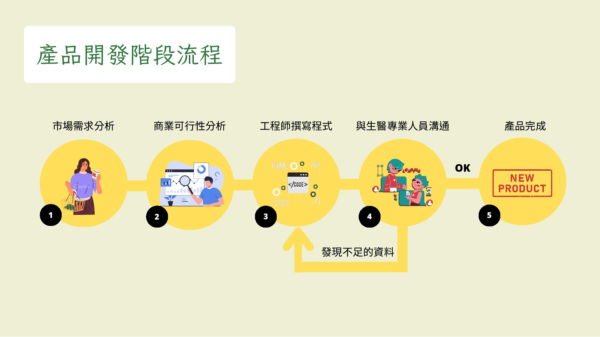

# 個案分析：從基因檢測到可理解的服務

[回到首頁](../README.md) · [產業分析](industry-analysis.md) · [商業模式](business-model.md)

## 研究問題與分析範圍

本案的分析單位是**基因檢測服務的價值形成與跨專業交接**，個案對象由使用者指定為先見基因科技。研究問題是：在技術專業與資訊不對稱都很高的市場中，企業如何把檢測能力轉成可理解、可交付且可能持續的服務價值？

原始團隊簡報提供產品分類、服務步驟、開發流程與人員知識地圖。本次把這些線索放進產業與商業模式脈絡，提出可檢驗的管理解釋。未取得企業內部紀錄，因此分析不是營運稽核，也不是實證因果研究。

## 個案背景：客戶購買的究竟是什麼？

原稿第 5–7 頁以健康風險、個人化用藥及基因銀行說明主題動機；第 10–13 頁列出多種服務；第 21–25 頁將採樣、DNA 萃取、分析與風險評估連成流程。這些材料呈現一個重要問題：產品可以被描述為一份檢測報告，但客戶期待的可能是對健康問題的理解與下一步方向。[原稿導覽](source-map.md)

**本次推論：**若只用「檢測完成」定義交付，可能低估解讀與溝通的價值。然而，理解需求不等於滿足所有健康期待。產品仍須說清楚能回答哪些問題、哪些問題需要專業人員進一步評估。

這個差距構成本案的管理主軸：如何讓技術產出、服務承諾與客戶理解一致。

## 關鍵矛盾一：產品多元化與服務邊界

原稿第 10 頁把健康風險評估、癌症伴隨性診斷、青春指數追蹤、祖源／親子鑑定、基因銀行等並列。這是一份產品範圍的歷史描述，不能直接視為同一套技術、同一個客群或同一種商業模式。

| 原稿的服務類型 | 本次分析的主要需求 | 應先確認的服務邊界 |
| --- | --- | --- |
| 健康風險評估 | 理解個人風險資訊 | 結果的適用範圍、限制與說明方式 |
| 癌症伴隨性診斷 | 支援特定醫療情境的判讀 | 適應情境、檢體與專業決策責任；本案未驗證產品 |
| 青春指數追蹤 | 理解追蹤指標 | 指標如何解釋，能否支持所宣稱的用途 |
| 祖源／親子鑑定 | 回答來源或關係問題 | 檢測目的與交付條件，不混用健康管理論述 |
| 基因銀行 | 後續使用既有資訊 | 保存、授權、版本與服務承諾的持續成本 |

以上是基於原稿分類的分析問題，不確認所有項目目前仍在販售。

**機制假說：**產品擴張能接觸更多需求，但也會增加銷售說明、品質管理與人員培訓的複雜度。若共用一套模糊的健康承諾，客戶可能高估不同產品的用途。

**替代解釋：**若企業已有成熟的分線團隊、用途說明與專業通路，產品多元化未必造成服務混淆。需查閱產品規格、實際服務腳本與客戶理解資料，才能判斷。

## 關鍵矛盾二：工程效率與專業判讀

原稿第 14 頁描繪市場需求分析、商業可行性分析、工程師撰寫程式、與生醫專業人員溝通及產品完成，並設有資料不足的回饋。第 23–29 頁則將分子生物學、醫學、資料庫運算、資料探勘與產品管理連結。

*歷史團隊簡報節選，未改寫內容；不等於公司正式 SOP。*

這些線索支持「需要跨領域合作」的描述，但還不足以說明合作是否順利、如何簽核、資料不足如何補齊，以及程式或資料庫變更如何影響報告。

**本次推論：**跨領域創新的難點可能在交接介面。工程師需要可運算、可測試的規格；生醫人員需要保留適用範圍與判讀限制；管理者需要清楚的交付時間與責任。

建議把合作具體化為四項交付物：用途與排除範圍、資料與分析版本、報告審核紀錄、例外處理責任。這些是本次提出的管理設計，未宣稱公司缺少或已採行。

**替代解釋：**瓶頸也可能來自檢體品質、通路承諾或產能，而不是專業溝通。應以返工原因與等待時間分布辨識問題，不能只依知識地圖判定根因。

## 關鍵矛盾三：一次性交易與長期服務

原稿第 7 頁用儲蓄與保險概念說明基因銀行。這個比喻有助於理解「先保存、後使用」，但並不證明公司提供保險保障，也不證明收入來自訂閱。

**本次推論：**長期資訊服務的價值，需要在客戶再次有需求時仍能被交付。企業須能辨識使用者、確認用途與授權、說明資料與解讀版本，並處理服務終止或移轉問題。這些責任會延續到初次檢測之後。

因此，基因銀行應同時從兩面分析：

- **需求面：**後續服務是否解決明確問題？客戶是否願意使用與付費？
- **供給面：**支援、更新、儲存與專業判讀成本，能否在所承諾期間維持？

2026-10-28 查閱的 [公司基因銀行頁](https://www.i-genomics.com.tw/zh-tw/bank.php) 同時出現長期服務定位，以及一年保存與年費加入的說明。這提供了具體的個案追問：保存期間、會員期間與後續服務期間如何對應？網頁文字不足以解釋完整契約，應取得方案條款與服務流程後再判斷，不能逕認承諾失實或認列經常性收入。

**替代解釋：**客戶可能只需要一次性資訊，或更信任既有醫療機構的後續服務。若沒有實際重複需求，長期保存也未必形成可持續的顧客關係。

## 為何這是產業個案，而不只是公司介紹？

這個案例讓我們看見四個可延伸到同類服務企業的問題：

1. **資訊不對稱：**使用者難以直接比較技術品質，企業需要把專業能力轉成可理解的證據與服務承諾。
2. **多方參與：**購買者、受測者、判讀者與後續決策者可能不是同一人，通路設計必須考慮不同角色。
3. **長期責任：**資料保存與重新解讀的承諾，需要對應持續的組織能力與成本。
4. **互補能力：**生醫、資料分析與管理能力各有價值，競爭差異可能來自它們如何共同工作。

這些是以個案線索形成的產業分析，不代表所有業者都有相同問題，也沒有建立市場排名。[產業結構分析](industry-analysis.md) 進一步拆解參與者與替代方案。

## 綜合判斷與決策

本案建議先檢查報告理解與服務交接，再決定是否擴大產品或長期資料服務。理由是：原稿已呈現多種產品與專業角色，而支撐持續價值的交接品質、客戶理解與服務成本仍缺乏資料。

這不是已驗證的最優策略。若後續資料顯示客戶理解充分、交接順暢，且主要限制來自產品範圍不足，應調整優先順序。具體指標與反證條件見 [策略與驗證設計](strategy-and-validation.md)。
