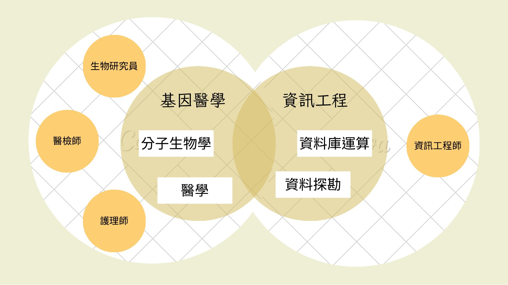
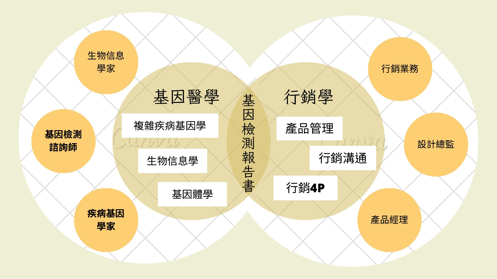

# 跨領域創新：把知識地圖變成協作機制

[回到首頁](../README.md) · [策略與驗證](strategy-and-validation.md)

原稿的獨特內容在第 18–29 頁：它將基因醫學、管理學與資訊工程分成三組配對，並列出人員與知識。以下保留原稿重點，再提出本次的機制解釋。

## 三個知識介面

| 原稿頁碼與配對 | 原稿呈現 | 本次追問 | 建議的交付物 |
| --- | --- | --- | --- |
| 第 21–25 頁：基因醫學 × 資訊工程 | 採樣、萃取、資料庫運算、資料探勘與風險評估 | 生醫問題如何變成可運算的規格？ | 資料字典、分析用途、版本與審核紀錄 |
| 第 26–27 頁：管理 × 資訊工程 | 消費者分析、市場推廣、產品開發與機器學習 | 哪個需求值得開發，系統應交付什麼？ | 需求優先順序、服務指標與例外分類 |
| 第 28–29 頁：基因醫學 × 管理 | 報告、行銷溝通、4P 與產品管理 | 如何保留專業限制，同時讓客戶看得懂？ | 用途說明、報告詞彙、轉介條件與溝通審查 |

原稿出現「機器學習」與「資料探勘」，支持課程對資訊技術的討論；不證明公司訓練了特定模型，也不支持模型準確率或臨床效能的主張。

*歷史團隊簡報第 25 頁，僅呈現知識與角色關係。*

## 一個可以共同討論的物件：報告

第 28–29 頁將「基因檢測報告書」放在知識交會處。**本次解釋：**報告可作為跨專業的共同工作物件，讓不同角色對同一份交付物協調：

- 生醫人員確認結果的意義、限制與適用情境。
- 工程人員確認資料來源、分析版本與呈現的一致性。
- 產品與服務人員確認用語、交付方式及客戶理解。

這個解釋比「三種人才一起工作」更具體，因為可以檢查誰審核了什麼、何時需要退回修改，以及版本改動由誰承接。原稿未提供這些紀錄，因此仍屬分析假說。

## Kano 與 IPA：從課程概念到調查設計

原稿第 19 頁使用 Kano 品質分類與 IPA 象限，但未附問卷、樣本數、計分規則或原始結果。不能將圖上的分類當成已完成的客戶實證。

Kano 的原始研究提出品質屬性與滿意關係的不同類型；本案只以此設計研究問題。[Kano 等，1984，期刊摘要](https://www.jstage.jst.go.jp/article/quality/14/2/14_KJ00002952366/_article)

IPA 將屬性的重要程度與表現一起觀察；象限的結論須依評分與切分方式而定，不能直接把課堂圖示當成企業表現。[Martilla 與 James，1977，出版者摘要](https://journals.sagepub.com/doi/10.1177/002224297704100112)

| 候選服務屬性 | Kano 研究問題 | IPA 研究問題 | 目前狀態 |
| --- | --- | --- | --- |
| 報告用途與限制清楚 | 有／沒有這項特徵時，客戶的反應如何？ | 客戶認為多重要，實際體驗如何？ | 未調查，不預填分類或象限 |
| 諮詢與轉介容易取得 | 是否屬於預期中的基本服務？ | 是否重要但表現不足？ | 未調查 |
| 報告交付時間可預期 | 不同等待資訊會如何影響感受？ | 是否值得投入改善？ | 未調查 |
| 資料用途與退出說明清楚 | 是否影響購買或持續使用意願？ | 不同客群評價是否一致？ | 未調查 |

研究應先訪談以確認屬性，再按產品用途與客群分組。品質與隱私的基本責任不能只由滿意度決定；消費者偏好也不能取代產品效能評估。

## 從概念走到可查核的協作

本案建議用「需求 → 規格 → 分析 → 審核 → 客戶回饋 → 版本修訂」追蹤一個服務改善。需保留變更原因、責任角色、影響產品與驗收條件，才能知道知識整合是否真的改善交付。

沒有這些證據時，本案能合理說明跨領域合作的必要性與可能機制，不能宣稱已證實組織學習、創新績效或機器學習成效。
